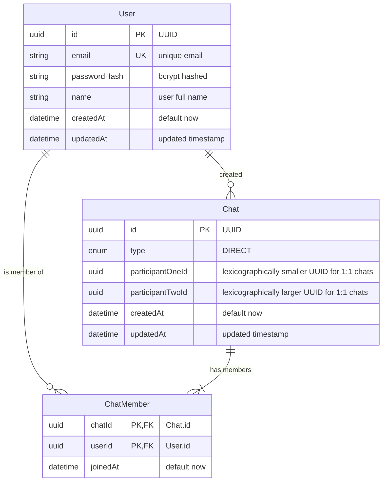

# Architecture Design: Chat Backend

## 1. System Overview

The system is a production-grade, high-performance Chat Backend designed around a **hybrid persistence architecture**:
- **PostgreSQL (via Prisma ORM)** serves as the relational source of truth for structured identity, chats, memberships, and relational integrity.
- **Google Cloud Firestore (via Firebase Admin SDK)** serves as the horizontally scalable, append-mostly source of truth for messages, idempotent read receipts, and per-user last-seen cursors.

```
                           +------------------------+
                           |      Client App /      |
                           |   Assessment Runner    |
                           +-----------+------------+
                                       |
                                       | HTTPS (REST / JSON)
                                       v
                           +------------------------+
                           |   Express.js Backend   |
                           |  (TypeScript / Node)   |
                           +----+--------------+----+
                                |              |
           Prisma ORM (SQL)     |              |   Firebase Admin SDK (NoSQL)
                                v              v
                     +------------------+  +--------------------+
                     |    PostgreSQL    |  |  Google Firestore  |
                     |  (Source of Truth|  |  (Source of Truth  |
                     |    for Users &   |  |   for Messages,    |
                     |   Chat Metadata) |  | Receipts, LastSeen)|
                     +------------------+  +--------------------+
```

---

## 2. Data Ownership and Storage Partitioning

| Domain Entity | Primary Store | Rationale |
|---|---|---|
| **Users** (`id`, `email`, `passwordHash`, `name`) | PostgreSQL | Strict uniqueness, relational constraints, credential management. |
| **Chats** (`id`, `type`, `createdAt`, `canonicalPair`) | PostgreSQL | Relational integrity, ACID uniqueness for 1:1 chats, group metadata. |
| **Chat Members** (`chatId`, `userId`, `role`, `joinedAt`) | PostgreSQL | Relational join integrity, authorization checks, participant indexing. |
| **Messages** (`id`, `chatId`, `senderId`, `text`, `createdAt`) | Firestore | High write throughput, distributed append-only storage, efficient timestamp indexing. |
| **Read Receipts** (`receipts/{userId}`) | Firestore | Sub-document isolation under messages, fast idempotent atomic updates. |
| **Last-Seen State** (`members/{userId}`) | Firestore | Rapid per-user cursor updates, document-level transactions for monotonicity checks. |

> [!IMPORTANT]
> **Strict Separation Rule**: Chat message bodies, message contents, read receipts, and last-seen cursors are **never** stored in PostgreSQL. PostgreSQL never handles message retrieval or storage.

---

## 3. Relational Schema Design (PostgreSQL / Prisma)



### Relational Constraints and Invariants
1. **Canonical Ordering for Direct (1:1) Chats**:
   When creating a direct chat between `User A` and `User B`:
   - `participantOneId = min(userAId, userBId)`
   - `participantTwoId = max(userAId, userBId)`
   - PostgreSQL unique constraint: `@@unique([participantOneId, participantTwoId])` where type = 'DIRECT'.
   - This guarantees at the database level that no two 1:1 chats can ever be created for the same user pair, even under high concurrency.
2. **Membership Uniqueness**:
   - `@@unique([chatId, userId])` prevents duplicate memberships.

---

## 4. Firestore Document Model

Firestore utilizes a hierarchical subcollection structure:

```
chats/
  └── {chatId}/
        ├── members/
        │     └── {userId}/
        │           ├── userId: string
        │           ├── lastSeenMessageId: string | null
        │           ├── lastSeenAt: Timestamp | null
        │           ├── lastSeenMessageCreatedAt: Timestamp | null
        │           └── updatedAt: Timestamp
        └── messages/
              └── {messageId}/
                    ├── id: string
                    ├── chatId: string
                    ├── senderId: string
                    ├── text: string
                    ├── createdAt: Timestamp (serverTimestamp)
                    ├── updatedAt: Timestamp | null
                    ├── isEdited: boolean (bonus)
                    ├── isDeleted: boolean (bonus)
                    └── receipts/
                          └── {userId}/
                                ├── userId: string
                                ├── readAt: Timestamp (serverTimestamp)
                                └── messageId: string
```

### Firestore Indexing and Query Guarantees
- **Chronological Message Ordering**:
  Query: `db.collection('chats').doc(chatId).collection('messages').orderBy('createdAt', 'asc').orderBy(FieldPath.documentId(), 'asc')`
  - Combining `createdAt` with document ID (`__name__`) ensures stable, deterministic ordering even if two messages arrive within the same millisecond.
- **Safe Cursor-Based Pagination**:
  - Request format: `GET /chat/:chatId/messages?limit=50&cursor=MESSAGE_ID`
  - Backend resolves the cursor document and applies `startAfter(cursorDoc)`.
  - Avoids offset pagination performance degradation.

---

## 5. Concurrency and Consistency Guarantees

### 1. Duplicate 1:1 Chat Prevention Under Concurrency
- **Problem**: Two users click "Start Chat" simultaneously, issuing two concurrent `POST /chat/create` requests.
- **Solution**:
  1. Determine canonical order: `[p1, p2] = [userA, userB].sort()`.
  2. Perform atomic Prisma transaction:
     ```ts
     const existing = await prisma.chat.findUnique({
       where: { participantOneId_participantTwoId: { participantOneId: p1, participantTwoId: p2 } },
     });
     if (existing) return existing.id;
     ```
  3. If not found, attempt `create` with both `Chat` and `ChatMember` records.
  4. If a race occurs, PostgreSQL throws unique constraint violation (`P2002`). The service intercepts this error and gracefully falls back to fetching the existing chat ID.
  5. The client always receives `200 OK` (existing) or `201 Created` with the single canonical chat ID.

### 2. Cross-Database Consistency Model
- **Failure Mitigation**:
  - **Scenario**: PostgreSQL chat creation succeeds, but subsequent Firestore initialization fails.
  - **Mitigation**: Lazy initialization in Firestore. Firestore document paths in `chats/{chatId}/messages` do not require a pre-existing root document to accept subcollection writes. PostgreSQL remains the absolute authority on chat existence and membership.
  - If a membership check fails in PostgreSQL, Firestore is never queried or touched.

### 3. Monotonicity Guarantee for Last-Seen Pointer
- **Problem**: Network latency or client retries might deliver a "last-seen" update for an older message *after* a newer message has already been recorded as last seen.
- **Solution**:
  Firestore transaction (`runTransaction`):
  1. Fetch target message `chats/{chatId}/messages/{messageId}`. If it doesn't exist or belongs to another chat, fail with `404 Not Found`.
  2. Fetch member state `chats/{chatId}/members/{userId}`.
  3. If `existing.lastSeenMessageCreatedAt` exists:
     - Compare timestamps: `targetMessage.createdAt` vs `existing.lastSeenMessageCreatedAt`.
     - If `targetMessage.createdAt < existing.lastSeenMessageCreatedAt`, reject update or return no-op (status: `ignored_older_than_current`).
     - If timestamps are equal, compare document IDs lexicographically. If target message is older, reject update.
  4. Only commit update if `targetMessage` is strictly newer.

### 4. Idempotent Read Receipts
- Target path: `chats/{chatId}/messages/{messageId}/receipts/{userId}`
- Writes use Firestore `.set({ userId, readAt: FieldValue.serverTimestamp(), messageId }, { merge: true })`.
- Repeated calls from the same user for the same message do not duplicate records.
