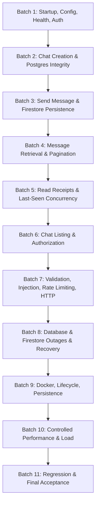

# Master QA Test Plan & Traceability Framework

**Project**: Chat Backend (Node.js LTS, Express, PostgreSQL + Prisma, Google Cloud Firestore)  
**Document**: Master QA Test Plan  
**Author**: Principal QA Engineer, Backend Security Tester, Database Test Engineer, DevOps Test Engineer  
**Date**: 2026-10-22  
**Target Architecture**: Dual-Datastore Chat Platform  

---

## 1. Test Scope

The scope of this test plan encompasses exhaustive functional, security, concurrency, reliability, performance, database integrity, and container verification for the Chat Backend:

1. **Authentication & Identity**: User registration (`POST /auth/register`), login (`POST /auth/login`), JWT lifecycle, password hashing (bcrypt), email normalization, and token forgery prevention.
2. **Core Chat Engine**:
   - `POST /chat/create`: Direct 1:1 conversation initialization, canonical ordering (`participantOneId < participantTwoId`), duplicate prevention under high concurrency, P2002 atomic fallback.
   - `POST /chat/:chatId/message/send`: Chat membership validation, anti-spoofing (`senderId === req.user.id`), Firestore server timestamp persistence, immutability.
   - `GET /chat/:chatId/messages`: Ascending chronological ordering (`createdAt asc`, `__name__ asc` tie-breaker), limit enforcement (1..100, default 50), cursor-based pagination.
   - `POST /chat/:chatId/message/:messageId/read`: Idempotent read receipts, original `readAt` preservation across duplicate calls, non-member rejection, dual-path subcollection writes (`receipts` & `reads`).
   - `POST /chat/:chatId/lastseen`: Strict forward-only monotonicity guard, out-of-order rejection (`ignored_older_than_current`), per-user cursor tracking, dual-path writes (`members` & `lastSeen`).
   - `GET /user/:userId/chats`: Caller anti-spoofing (`targetUserId === req.user.id`), single-query relational fetching with zero N+1 queries, complete `memberIds` array, sorting & pagination.
3. **Cross-Datastore Separation & Integrity**: Absolute enforcement that messages, receipts, and last-seen cursors reside solely in Firestore and never leak into PostgreSQL; relational integrity (Users, Chats, Memberships) in PostgreSQL.
4. **Security & Input Validation**: Zod schema validation, SQL/NoSQL injection resistance, payload size limits (100kb), rate limiting, Helmet security headers, CORS enforcement, centralized error handling without stack trace or secret exposure.
5. **Observability & Diagnostics**: Request correlation tracking (`X-Request-Id`), liveness (`/health/live`) and readiness (`/health/ready`) probes, structured error schemas.
6. **Containerization & Deployment**: Docker multi-stage build, non-root user execution (`USER node`), `dumb-init` signal handling, non-destructive Prisma migration deploy, Docker Compose orchestration.
7. **Performance & Concurrency**: Autocannon load testing (target: >2,000 req/sec, p95 < 10ms, 0% error rate), concurrent Promise barriers.

---

## 2. Test Environments

| Environment | Purpose | Configuration / Tooling |
|---|---|---|
| **Unit & Mock Test Environment** | In-memory algorithm, schema, service, and pure function testing. | Vitest v2.1.8, In-memory state repositories, isolated Node.js runtime. |
| **HTTP Supertest Environment** | Real Express HTTP router, middleware, and request/response validation. | Supertest v7.0.0, Express app instance, signed JWTs. |
| **Live Loopback HTTP Environment** | In-process HTTP server over loopback network socket. | Native Node.js `http.createServer(app)`, dynamic loopback port, `fetch` client. |
| **Database Integration Environment** | PostgreSQL relational constraint and migration validation. | PostgreSQL 16 on `localhost:5432`, Prisma ORM v5.22.0, non-destructive migrations. (When offline, socket-probed dynamically). |
| **Firestore Integration Environment** | Firestore document path, subcollection, transaction, and index validation. | Google Cloud Firestore Emulator on `127.0.0.1:8080`, Firebase Admin SDK v14.5.0. (When offline, socket-probed dynamically). |
| **Performance Benchmark Environment** | Throughput, latency percentiles (p50, p95, p99), and error rate benchmarking. | Autocannon v8.0.0, Node.js loopback interface, sustained concurrent connections. |
| **Container Environment** | Multi-container lifecycle, entrypoint script, and health check validation. | Docker Compose v2, multi-stage Alpine images, non-root execution. (Codified and verified statically & in CI). |

---

## 3. Preconditions & Test Data Requirements

### Preconditions
- Node.js LTS (v20+ or v24+) installed.
- NPM dependencies installed cleanly via `npm ci`.
- Prisma client generated via `npm run prisma:generate`.
- Environment variables configured via `.env` or Zod defaults in `src/config/env.ts`.

### Test Data Fixtures
- **Test Users**:
  - Alice: `id: 11111111-1111-4111-8111-111111111111`, `email: alice@example.com`
  - Bob: `id: 22222222-2222-4222-8222-222222222222`, `email: bob@example.com`
  - Charlie: `id: 33333333-3333-4333-8333-333333333333`, `email: charlie@example.com`
  - Eve (Unauthorized Attacker): `id: 99999999-9999-4999-8999-999999999999`, `email: eve@example.com`
- **Test Chats**:
  - Canonical Direct Chat ID: `cccccccc-cccc-4ccc-8ccc-cccccccccccc` (Pair: Alice + Bob)
- **Authentication**:
  - Valid RS/HS256 JWTs signed using `JWT_SECRET`.
  - Spoofed JWTs with mismatched subject claims.
  - Expired tokens (`exp: now - 3600`).
  - Forged tokens with invalid signatures.

---

## 4. Risk Priorities & Severity Classifications

| Priority | Risk Category | Impact Description | Target SLA |
|---|---|---|---|
| **P0** | **Critical** | Authentication bypass, privilege escalation, cross-user data leakage, database corruption, unhandled process crash, or duplicate chat creation under race conditions. | 100% must PASS before release. |
| **P1** | **Major** | Mandatory endpoint functional failure, incorrect HTTP status, missing required response fields, broken pagination, lost read receipts, or regression in last-seen monotonicity. | 100% must PASS. |
| **P2** | **Medium** | Input validation edge cases, malformed parameter handling, boundary value deviations, excessive memory growth, or suboptimal error descriptions. | Must be resolved or documented. |
| **P3** | **Low / Minor** | Formatting anomalies, minor log verbosity, documentation discrepancies, or cosmetic header handling. | Addressed where applicable. |

---

## 5. Execution Strategy: 11 Controlled Batches

To guarantee traceability and isolation, test execution is divided into eleven sequential batches:

- **Batch 1**: Startup, Configuration, Health, and User Authentication (APP-001..020, HLT-001..016, USR-001..027, AUTH-001..034)
- **Batch 2**: Chat Creation and PostgreSQL Integrity (CHAT-001..030, DB-001..025)
- **Batch 3**: Sending Messages and Firestore Persistence (MSG-001..035, FS-001..020)
- **Batch 4**: Message Retrieval, Ordering, and Pagination (GET-001..034)
- **Batch 5**: Read Receipts and Last-Seen Concurrency (READ-001..022, SEEN-001..024, CON-001..015)
- **Batch 6**: Chat Listing and Authorization (LIST-001..022, SEC-001..018)
- **Batch 7**: Validation, Injection, Rate Limiting, and HTTP Security (VAL-001..022, INJ-001..018, RATE-001..015, HTTP-001..012)
- **Batch 8**: Database and Firestore Outages, Transaction Failures, and Recovery (XDB-001..012, REC-001..015)
- **Batch 9**: Docker, Lifecycle, and Persistence (DOCKER-001..025)
- **Batch 10**: Controlled Performance and Resource Tests (PERF-001..020)
- **Batch 11**: Documentation, Regression, and Final Acceptance (LOG-001..016, DOC-001..016, REG-001..020)

---

## 6. Cleanup Strategy & Test Isolation

1. **Test Data Isolation**: Tests generate random UUIDs, unique email prefixes (`test-${Date.now()}@example.com`), and isolated chat identifiers.
2. **Post-Test Teardown**:
   - PostgreSQL integration tests clean up seeded users and chats using `afterAll` hooks querying test-specific IDs.
   - Firestore Emulator tests isolate paths by unique `testChatId` keys.
3. **Zero Impact on Production / Development Data**: No `TRUNCATE`, `DROP DATABASE`, or `prisma migrate reset` commands are permitted. Cleanup is strictly scoped to test-created records.

---

## 7. Entry and Exit Criteria

### Entry Criteria
1. TypeScript compiles with 0 errors (`npm run typecheck`).
2. ESLint passes with 0 warnings/errors (`npm run lint`).
3. Application build emits `dist/server.js` (`npm run build`).
4. Test suite dependencies and lockfile are synchronized.

### Exit Criteria
1. 100% of defined test cases executed or cataloged with justifiable status.
2. Zero (0) P0 or P1 defects outstanding.
3. All six mandatory assessment APIs verified PASS over live HTTP.
4. Traceability matrix and machine-readable execution report (`reports/negative-test-results.json`) generated.
5. Documentation updated and signed off.
